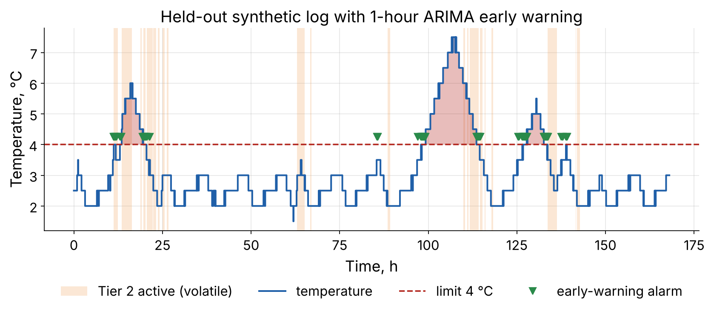
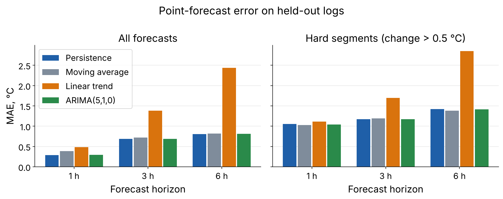
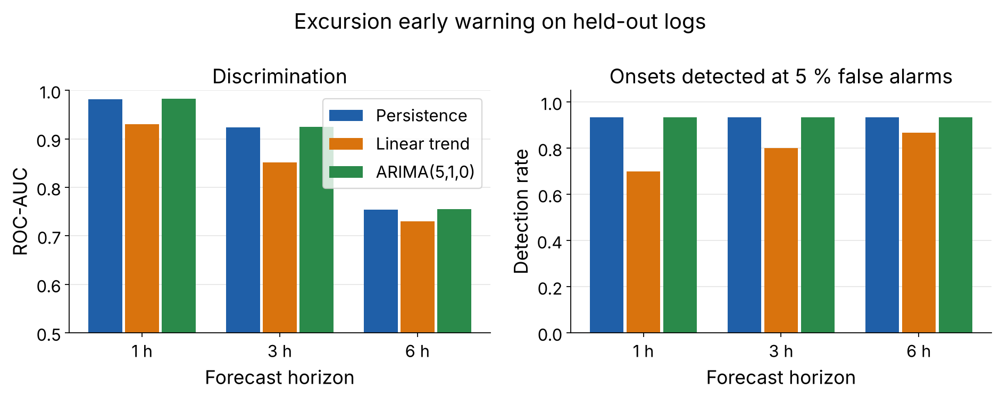

# coldchain-monitor

[](https://github.com/YOUR_USERNAME/milk-coldchain-monitor/actions/workflows/ci.yml)
[](LICENSE)


Forecasting and excursion early warning for the cold-storage temperature of
**pasteurized milk**. The package is the always-on tier ("Tier 1") of the
two-tier monitoring cascade proposed in the master's thesis *"Mathematical
modeling of digitalization processes in the production of national dairy
products"* (Astana IT University).



## The problem

Pasteurized milk must be stored at 0-4 °C. A monitoring system that only
reports *after* the limit is exceeded reacts too late. This package answers
two questions from a 5-minute temperature stream:

1. **Point forecast** - what will the temperature be in 1, 3 or 6 hours?
2. **Excursion early warning** - will it exceed 4 °C within that horizon,
   given that it is within the limit now?

## What is implemented

| Module | Content |
|---|---|
| `forecasting.py` | Persistence, moving average (1 h), linear trend (30-min slope), **ARIMA(5,1,0)** re-fitted on a sliding 24 h window with a stability correction |
| `warning.py` | Excursion labels, ROC-AUC, average precision, threshold at a fixed false-alarm rate, event-level detection rate / lead time / false alarms per day |
| `features.py` | 13 look-ahead-free features (differences at 5-180 min, rolling max / min / std / mean) for the machine-learning tier |
| `cascade.py` | Volatility trigger that decides when the heavier Tier 2 model should run |
| `evaluation.py` | Comparison of the methods: thresholds from calibration logs, metrics on held-out logs |
| `data.py` | CSV input/output and a synthetic cold-store generator for tests and demos |
| `plotting.py`, `cli.py` | Figures and the `coldchain` command |

### ARIMA(5,1,0) and its stability correction

An autoregression of order 5 is fitted to the first differences of the last
288 readings (24 h) by ridge least squares (lambda = 1e-3):

```
dy[t] = phi1*dy[t-1] + ... + phi5*dy[t-5]
```

Multi-step forecasts stay bounded only if every eigenvalue of the companion
matrix of `phi` has modulus below one. If a fit violates this, the
coefficients are shrunk uniformly (`phi <- c*phi`, c < 1) until all moduli
are below 0.98. Without the correction a single unstable fit makes the
forecast diverge and inflates the error by orders of magnitude; the test
suite contains a regression test for exactly this case.

### Two-tier cascade

```
Tier 1 (always on):   persistence / ARIMA(5,1,0)
Tier 2 (conditional): machine-learning classifier, active when
                      std12 > tau0  or  std36 > tau1
```

`std12` and `std36` are the rolling standard deviations over 1 h and 3 h.
Tier 2 itself (Random Forest / Gradient Boosting) and the tuning of
`tau0`, `tau1` are on the roadmap.

## Data

> **Important.** The repository contains **no real sensor data**. The bundled
> log and everything produced by `examples/run_demo.py` come from a synthetic
> generator (thermostat cycling, door openings, cooling faults, 0.5 °C sensor
> resolution). These results show that the software works; they say nothing
> about how the methods rank on a real cold chain. The research results of
> the thesis were obtained on public real-world logs (the Kaggle "Data Sets
> Cold Chain Milk" collection and a commercial cold-room deployment), which
> must be downloaded separately and converted to the CSV format below.

CSV format: a header row and a `temperature_c` column on a regular 5-minute
grid (an optional `time_min` column is ignored).

## Installation

```bash
git clone https://github.com/YOUR_USERNAME/milk-coldchain-monitor.git
cd milk-coldchain-monitor
python -m venv .venv
source .venv/bin/activate        # Windows: .venv\Scripts\activate
pip install -e ".[dev]"
```

Requires Python 3.10 or newer; the only runtime dependencies are NumPy and
Matplotlib.

## Quick start

```bash
coldchain generate my_log.csv --hours 168 --seed 1
coldchain forecast data/example_log.csv --hours 3
coldchain evaluate --calibration a.csv b.csv --test c.csv d.csv --horizons 1 3 6
python examples/run_demo.py      # full comparison + figures in docs/figures
```

```python
from coldchain_monitor import read_csv, arima_forecast_path, tier2_active

log = read_csv("data/example_log.csv")
path = arima_forecast_path(log.temperature, steps=36)      # next 3 hours
if path.max() > 4.0:
    print("warning: excursion expected within 3 h")
print("Tier 2 needed now:", bool(tier2_active(log.temperature)[-1]))
```

## Demo output (synthetic logs)

Ten logs calibrate the alarm thresholds (5 % false-alarm rate), ten are held
out. The table is regenerated by CI on every push
([`docs/demo_results.txt`](docs/demo_results.txt)).

| Forecast error | Early warning |
|---|---|
|  |  |

## Tests and code quality

```bash
pytest --cov            # 65 unit tests
ruff check .            # static analysis
```

The tests check, among other things: recovery of known AR coefficients,
bounded forecasts after the stability correction, absence of look-ahead in
the features, hand-worked examples for the labels and metrics, and the CSV
and command-line interfaces.

## Continuous integration and delivery

* [`.github/workflows/ci.yml`](.github/workflows/ci.yml) - on every push and
  pull request: lint, tests on Python 3.10 / 3.12 / 3.13 (Linux) and 3.12
  (Windows), the demo (figures and table stored as an artifact), package build.
* [`.github/workflows/release.yml`](.github/workflows/release.yml) - on a tag
  `v*`: tests, builds the wheel and source archive, publishes a GitHub Release.

## Why these technologies

| Choice | Reason |
|---|---|
| Python 3.10+ | Standard language of data science; free; the same language serves the later ML tier and plant integration |
| NumPy | The whole Tier 1 (ridge least squares, eigenvalues, rolling statistics) needs nothing else, so the monitor stays light enough for an edge device |
| Matplotlib | Publication-quality figures; works without a display in CI |
| pytest + pytest-cov | De-facto standard test runner with coverage |
| Ruff | One fast tool for lint rules and import order |
| GitHub Actions | CI/CD integrated with the repository, free for public projects |
| `pyproject.toml` | One standard file for metadata, dependencies and tool settings |

scikit-learn is deliberately *not* a dependency yet: it will be added as an
optional extra together with Tier 2.

## Roadmap

See the [issues](https://github.com/YOUR_USERNAME/milk-coldchain-monitor/issues):
loader for the public milk cold-chain logs, Tier 2 classifiers, tuning of the
cascade thresholds, grouped cross-validation, and - later - extension to
other national dairy products (kumis, shubat).

## Citation and license

If you use this software, please cite it using [`CITATION.cff`](CITATION.cff).
Released under the [MIT License](LICENSE).

## References

1. Box G.E.P., Jenkins G.M., Reinsel G.C., Ljung G.M. *Time Series Analysis:
   Forecasting and Control*, 5th ed. Wiley, 2015.
2. Hassoun A. et al. Birth of dairy 4.0: opportunities and challenges in
   adoption of fourth industrial revolution technologies in the production of
   milk and its derivatives. *Curr. Res. Food Sci.*, 2023, 7, 100535.
3. Harris C.R. et al. Array programming with NumPy. *Nature*, 2020, 585,
   357-362.
